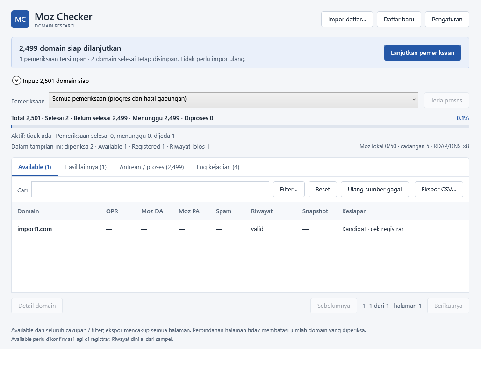
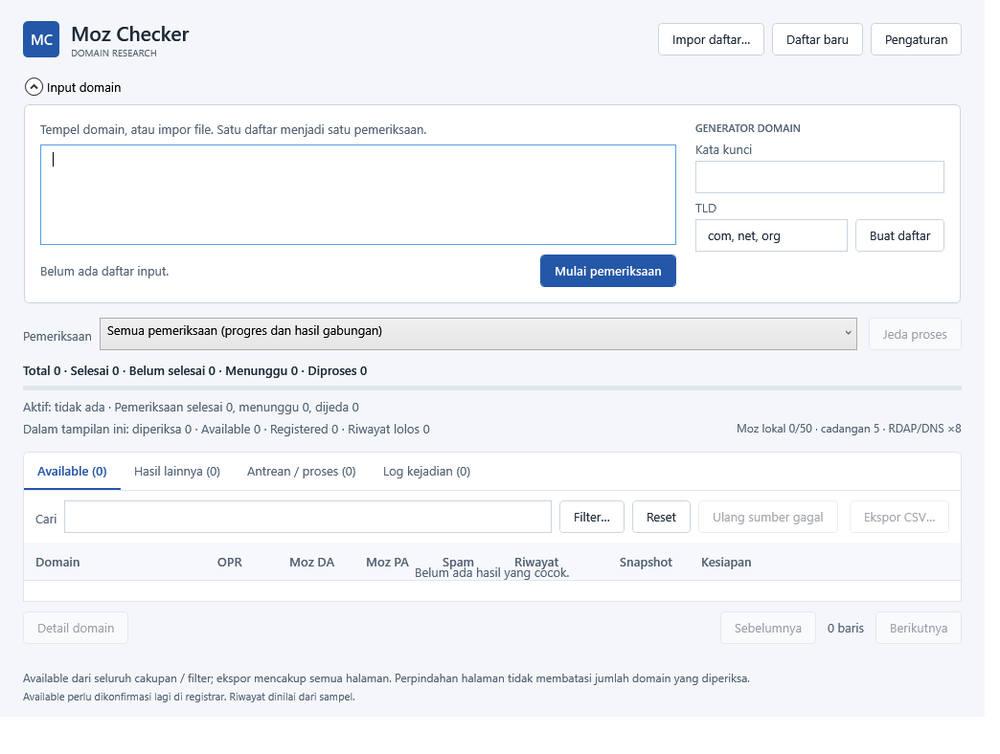
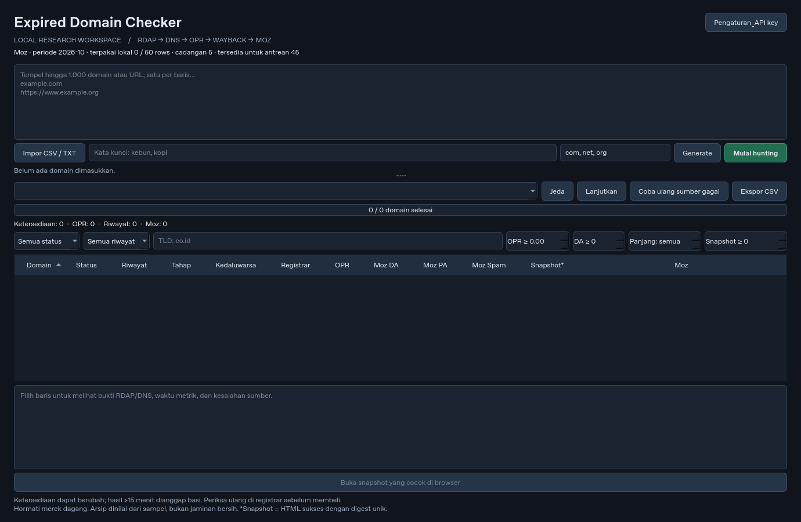

# Moz Checker — C# / WPF for Windows 11

Versi desktop C# (v0.5.0 Preview) menggunakan **C# + .NET 10 WPF**, tanpa Python di paket Windows. Paket kecil membutuhkan **.NET 10 Desktop Runtime x64** yang dipasang terpisah. Lihat [migrasi dan cara build](docs/DOTNET-MIGRATION.md). [Unduh v0.5.0 Preview](https://github.com/bisrib613/moz-checker/releases/tag/v0.5.0). Publikasi preview ini dibatasi ke paket C# yang telah diverifikasi; investigasi paket Python lama masih terbuka.

**Workspace v0.5.0:** saat data lama tersedia, banner **Lanjutkan pemeriksaan** menampilkan jumlah domain tersisa dan input baru tertutup. Pilih **Semua pemeriksaan** untuk antrean lama; tidak perlu impor ulang. Resume mengikuti checkpoint, retry hanya menjadwalkan sumber yang perlu diperiksa, dan concurrency RDAP/DNS dapat diatur 1–32 (default 8).

[Review kode dan alur kerja](docs/CODE-REVIEW-0.5.0.md) · [Layout kompak](docs/desktop-resume-compact.png)



**Daftar besar v0.4.0:** satu impor menjadi satu pemeriksaan penuh, tanpa pemecahan per 1.000 domain atau batas file 5 MB. CSV/TXT/TSV langsung diparse dan dideduplikasi. Pratinjau input dan tabel dibagi per 200 baris; seluruh daftar tetap diproses, dicari, dan diekspor.

**Antarmuka:** toolbar dan tabel native Windows, tanpa kartu dashboard. Tab **Available**, **Hasil lainnya**, **Antrean / proses**, dan **Log kejadian** memisahkan hasil, pekerjaan menunggu, serta kejadian aktual. Log tersimpan, bertimestamp, dan terbaru di atas. Pilih **Semua pemeriksaan → Lanjutkan** untuk melanjutkan seluruh sesi lama yang dijeda; hasil lama dipertahankan.



Implementasi Python di bawah dipertahankan sebagai referensi versi 0.2.0; perintah Python bukan cara menjalankan desktop WPF baru.

# Expired Domain Checker

> **Status keamanan Windows:** Ada laporan Defender mengarantina `MozChecker.exe` sebagai `Behavior:Win32/DefenseEvasion.A!ml` (Severe). Penyebab belum dipastikan. Jangan menjalankan atau memulihkan file yang dikarantina dan jangan menonaktifkan antivirus. Paket lama tetap dalam investigasi; v0.4.0 C# diterbitkan sebagai preview dengan bukti pengujian dan batasannya. Lihat [investigasi](docs/SECURITY-INVESTIGATION.md).

Aplikasi desktop Windows untuk riset expired domain. Data hunting dan cache berada di SQLite lokal; key berada di credential vault sistem. Tidak ada server pusat, pembelian domain otomatis, atau scraping tool SEO.

## Jalankan di Windows

Target awal: Windows 10/11 64-bit, Python 3.12. Instal [uv](https://docs.astral.sh/uv/getting-started/installation/), lalu di PowerShell dari folder repo:

```powershell
uv sync --frozen --extra dev
uv run --frozen --extra dev moz-checker
```

Buka **Pengaturan & API key** untuk mengisi key opsional. Tanpa key, RDAP/DNS dan Wayback tetap berjalan. Key tidak diperlukan untuk menjalankan tes. SQLite disimpan di `%LOCALAPPDATA%/MozChecker/checker.sqlite3`. Jangan membagikan database jika ingin menjaga daftar domain tetap privat. `MOZ_CHECKER_DATA_DIR` dapat mengubah lokasi data, bukan lokasi API key.

Build portable (harus dijalankan di Windows):

```powershell
./scripts/build-windows.ps1
```

Distribusikan seluruh folder `dist/MozChecker`, bukan hanya `.exe`. Workflow GitHub Actions menjalankan pengujian Linux/Windows dan menghasilkan artefak Windows ketika workflow dijalankan. Build belum ditandatangani. Workflow menguji Windows dan executable secara otomatis; pengujian manual pada desktop Windows serta akun API nyata tetap diperlukan sebelum penggunaan produksi.

## Antarmuka v0.2.0

Workspace baru memakai sidebar input, kartu ringkasan terpisah, pencarian shortlist, filter dialog, dan bukti domain yang dibuka saat diperlukan (klik dua kali baris atau tombol Bukti pemeriksaan). Pengaturan API dan aturan hunting berada di dua tab. Shortcut: Ctrl+Enter mulai/antrekan, Ctrl+O impor, Ctrl+F cari, Ctrl+koma pengaturan. Ekspor hanya aktif pada tab hasil dengan baris yang terlihat. Data lokal versi sebelumnya tetap kompatibel.



Lihat [design system desktop](design-system/moz-checker/MASTER.md) untuk prinsip layout dan aksesibilitas.

## Alur penggunaan

1. Tempel domain/URL, impor CSV/TXT UTF-8, atau buat kombinasi kata kunci + TLD. Maksimal 1.000 domain unik; URL, `www`, huruf besar, dan IDN dinormalisasi. CSV dengan header `domain` dapat diimpor ulang. Public Suffix List bawaan menolak subdomain (selain awalan www yang dihapus) dan public suffix seperti co.id; keduanya bukan domain yang bisa didaftarkan. TLD belum dikenali PSL dianggap unknown sampai dependency diperbarui.
2. Klik **Mulai hunting**. Hunting baru masuk antrean saat ada hunting aktif. Hasil muncul per domain. **Jeda** menghentikan antrean dengan mempertahankan hasil; **Lanjutkan** melanjutkan hunting terpilih. Menutup aplikasi menyimpan job aktif untuk dilanjutkan saat dibuka lagi.
3. Available berarti rute RDAP HTTPS berasal dari bootstrap IANA, respons protokol RDAP `errorCode: 404`, dan DNS SOA menghasilkan NXDOMAIN. Web 404 generik, timeout DNS, atau TLD tanpa RDAP menghasilkan unknown. WHOIS belum tersedia; kasus tersebut sengaja tidak disimpulkan available.
4. OPR memakai batch ≤100 domain dan cache 30 hari. OPR tetap terpisah dari Moz DA/PA. Nilai kosong berbeda dari angka 0. Ambang OPR untuk tahap arsip dapat diatur; tanpa skor OPR, pemeriksaan gratis tetap berjalan.
5. Wayback mengambil metadata HTML 200 dengan digest unik, kemudian memindai sampai 5 sampel tersebar (dapat diatur). Script/style tidak dipindai sebagai teks terlihat. Hasil invalid menyertakan kata yang cocok dan tautan snapshot. Isi arsip tidak dirender di aplikasi dan tidak disimpan. Tidak ada snapshot boleh dianggap valid melalui pengaturan. Gagal mengambil salah satu sampel menghasilkan unchecked, kecuali ada temuan invalid.
6. Domain valid otomatis masuk jalur Moz serial. Batas lokal default 50 rows/periode, cadangan 5; **ini bukan klaim paket gratis atau saldo akun Moz**. Ubah batas dan ID periode tagihan sesuai akun. Permintaan dicatat sebelum dikirim; gagal/terputus tetap dihitung dan tidak diulang otomatis. Tombol coba ulang memperbaiki sumber gratis/no-key/kuota, tetapi tidak mengulangi Moz yang mungkin sudah ditagih. Untuk retry Moz tersebut, periksa saldo provider sebelum membuat hunting baru.
7. Tab **Hasil available** hanya memuat domain berstatus available. Domain registered, redemption, pending delete, unknown, serta antrean dicatat di **Log pemeriksaan** dengan bukti dan kesalahan; hasil lama juga mengikuti tampilan ini tanpa migrasi database. Penghitung memisahkan sudah diperiksa, available, dan registered. Filter riwayat, TLD, panjang label pertama, OPR, DA, snapshot; klik header untuk urut. Ekspor CSV mencakup baris yang tampil, bukti, kesalahan, dan waktu metrik. Formula spreadsheet dinetralkan. Tidak ada hasil yang menjamin domain dapat dibeli.

Ketersediaan diperbarui sebelum Moz jika sudah berumur 15 menit; hasil CSV/UI berumur >15 menit tidak ditandai `ready`. `ready` berarti available segar + riwayat lolos, bukan rekomendasi pembelian. Cek lagi di registrar sebelum membeli.

## Penyedia, akses, dan batasan

| Sumber | Endpoint / perilaku |
| --- | --- |
| IANA | `https://data.iana.org/rdap/dns.json`, cache 7 hari |
| RDAP | Rute HTTPS per TLD dari IANA; maksimal sekitar 2 request/detik per host; cache 15 menit |
| DNS | Resolver DNS sistem, SOA, timeout 5 detik |
| Open PageRank | `https://openpagerank.domcop.com/api/v1.0/getPageRank`, header `API-OPR`, ≤100 domain/request, interval 1,1 detik |
| Wayback | `https://web.archive.org/cdx/search/cdx` dan `/web/…id_/…`; satu gate 4,1 detik mencakup metadata dan isi |
| Moz Links API v2 | `https://lsapi.seomoz.com/v2/url_metrics`, HTTP Basic **Access ID + Secret**, satu target/request, interval 10,1 detik |

**Integrasi Moz adalah adapter v2/legacy, bukan token JSON-RPC v3.** Akun yang hanya memiliki token v3 tidak didukung. Bootstrap IANA serta RDAP .com/.net/.org berhasil diperiksa live di cloud. DNS sistem cloud gagal merespons; OPR, Moz, dan RDAP .id belum tervalidasi karena pembatasan/kegagalan jaringan dan tidak ada key akun. Dokumentasi DomCop mengalihkan ke keywordseverywhere.com, yang belum dapat diakses. Jangan mengasumsikan kuota/harga PRD masih berlaku. Lihat [catatan validasi](docs/VALIDATION.md). Permintaan Moz tidak dicoba ulang otomatis karena risiko tagihan ganda. Retry sumber lain menghormati Retry-After; jika >120 detik, job mencatat kegagalan untuk dicoba nanti. Semua TLS verification tetap aktif dan redirect tidak diikuti, sehingga header key tidak dikirim ke host lain.

Batas arsip: 10.000 metadata digest unik per domain, respons metadata ≤3 MB, isi snapshot ≤2 MB. Melebihi batas menghasilkan unchecked, bukan hasil bersih. Jumlah snapshot adalah jumlah HTML sukses/digest unik yang diperiksa CDX, bukan seluruh tangkapan Wayback. Pemindaian kata kunci dan sampel dapat menghasilkan false positive/negative. Waktu total Wayback untuk ratusan domain dapat jauh lebih lama dari 10 menit; target PRD 10 menit berlaku ketersediaan + OPR dan belum diukur dengan layanan nyata.

Domain didistribusikan ke DNS, registry RDAP, Open PageRank, Wayback, dan Moz sesuai tahap. API key hanya dikirim ke penyedia yang sesuai. Tidak ada telemetry pusat. Teks snapshot tidak disimpan dalam database atau ditampilkan. Berkas database tetap berisi domain, metrik publik, status, kata temuan, dan URL bukti.

## Development dan tes

```bash
# Cloud: gunakan checkout yang ada, tidak perlu worktree baru.
bash scripts/install.sh
# Desktop Linux dengan GUI dan credential vault yang didukung:
.venv/bin/python -m moz_checker
# Cloud tanpa display:
QT_QPA_PLATFORM=offscreen .venv/bin/python -m moz_checker --smoke
```

Tes memakai respons terkontrol: aturan bukti ganda, batching/cache, sampling, kegagalan sumber, kuota, recovery, ekspor, dan interaksi UI. Tes tidak memakai kuota API dan tidak mengklaim bahwa endpoint live tervalidasi. Cloud headless tidak menyediakan Windows Credential Manager; jangan memakai keyring teks sebagai pengganti.

Struktur: `models.py` normalisasi/hasil; `providers.py` jaringan/rate limiting; `engine.py` antrean/pipeline; `store.py` SQLite/cache/kuota/CSV; `secrets.py` credential vault; `ui.py` desktop.

F8 filter dasar sudah tersedia. Watchlist/notifikasi harian (F10), heuristik lonjakan spam (F11), installer/update otomatis, dukungan Moz v3, dan WHOIS fallback belum diimplementasikan. Windows portable build dan pengujian akun API nyata tetap merupakan pemeriksaan rilis yang wajib.

## Publikasi GitHub Release

Setelah workflow **Test and Windows desktop build** untuk push ke `main` sukses, jalankan **Publish verified Windows release** dari tab Actions. Isi tag versi yang sesuai `pyproject.toml` dan ID build yang sukses. Catatan rilis harus tersedia di `docs/releases/<tag>.md`. Publisher mengambil artefak dari run tersebut, memeriksa asal workflow/commit, versi, checksum, ZIP dan PE x64, lalu membuat pre-release dengan paket portable serta `SHA256SUMS.txt`. Token bawaan GitHub Actions digunakan; tidak perlu menaruh personal access token di source atau settings aplikasi. Release yang sudah ada tidak ditimpa.
